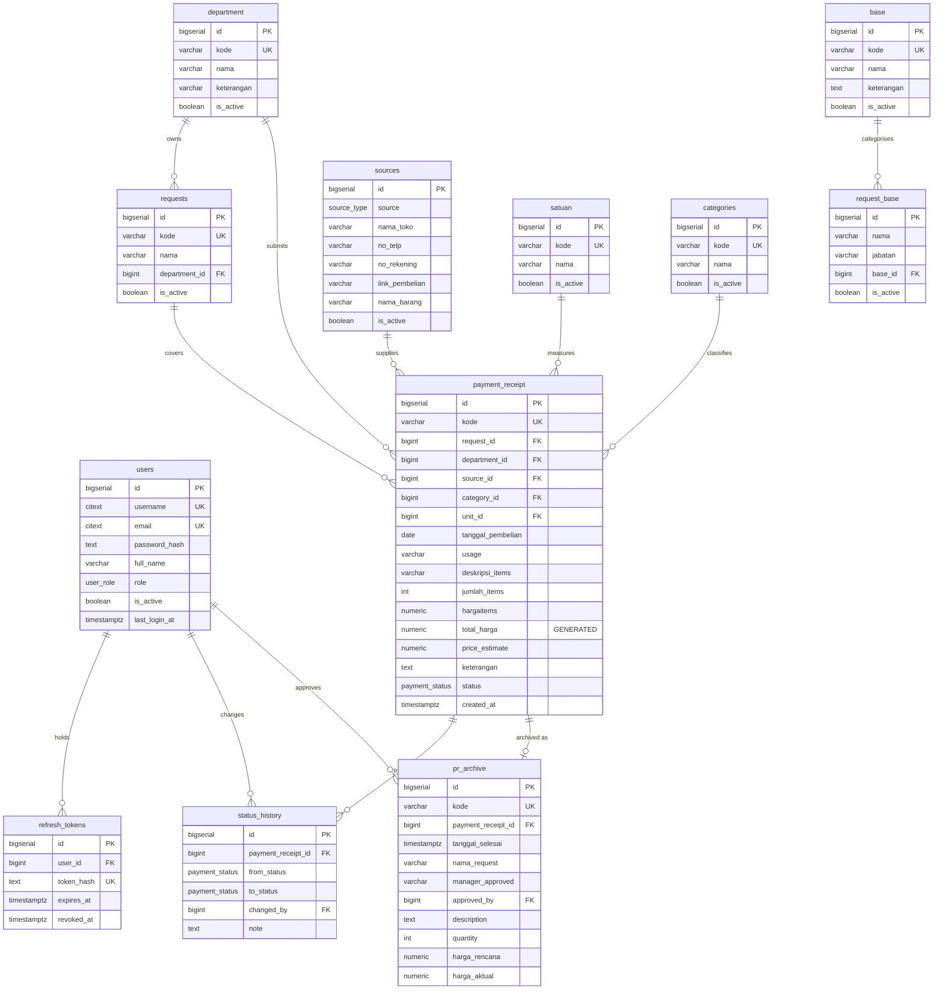
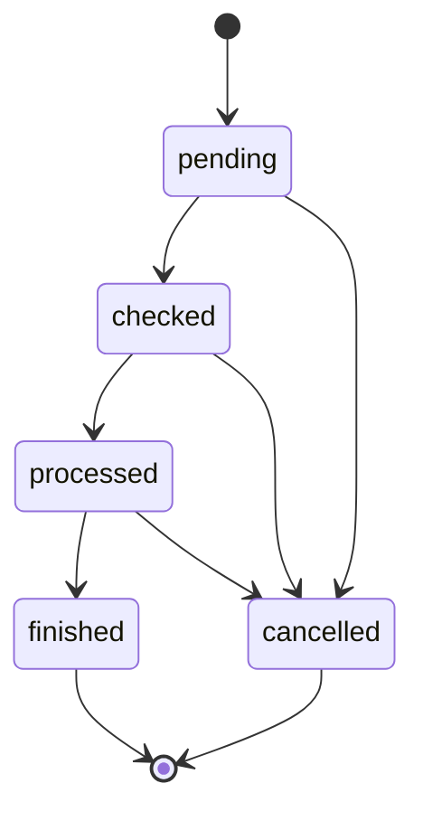

# ERD — Payment Receipt v2

Skema database `paymentreceipt_v2`. Dokumen ini adalah **kontrak skema**: migrasi di
`backend/db/migrations/` harus mengimplementasikan persis apa yang tertulis di sini.

> **Catatan penting.** Skema ini **direkonstruksi**, bukan disalin. Aplikasi legacy tidak punya
> file `.sql` — `koneksidb.php` hilang, jadi definisi tabel aslinya tidak pernah bisa dibaca.
> Kolom di bawah berasal dari query yang ada di kode legacy, lalu diperbaiki.
> Lihat [ADR-0001](adr/0001-greenfield-rewrite.md) § Risiko.

---

## Diagram



---

## Tipe & Enum

| Tipe | Nilai | Kegunaan |
|---|---|---|
| `user_role` | `admin`, `ga_staff`, `approver`, `viewer` | Otorisasi |
| `source_type` | `online`, `offline` | Mode pembelian |
| `payment_status` | `pending`, `checked`, `processed`, `finished`, `cancelled` | Alur transaksi |

### Alur `payment_status`



`cancelled` adalah **terminal**. Transisi di luar diagram ini ditolak dengan `409 Conflict`.
Implementasi ada di `internal/domain` dan wajib punya test (T6.9).

---

## Perbedaan terhadap Legacy

| Aspek | Legacy | v2 | Alasan |
|---|---|---|---|
| Nama tabel utama | `generalaffairspayment` | `payment_receipt` | Nama lama tidak deskriptif |
| Primary key | `GApayment_id` | `id` (bigserial) | Konvensi Go, nullable-friendly |
| Kode dokumen | tidak ada | `kode` (unique) | Legacy tidak punya nomor dokumen — PDF jadi tidak bisa dirujuk |
| Kategori | kolom teks `categories` **dan** FK `kategori_id` (duplikat) | hanya `category_id` FK | Sumber data ganda = data bisa tidak sinkron |
| Satuan | kolom `units_id` + teks hasil join | hanya `unit_id` FK | Sama |
| Total harga | dikirim dari client (`$_POST['total_harga']`) | `GENERATED ALWAYS AS (jumlah * harga) STORED` | Client bisa mengirim angka palsu |
| `base` | dua kolom: `base_id` **dan** `kode_base` | satu `kode` | Duplikat |
| `sourcesproc` | `source` varchar bebas | enum `source_type` + CHECK per mode | Legacy bisa tersimpan nilai tidak valid |
| Status | varchar bebas, `CASE` di setiap query | enum `payment_status` | Legacy bisa punya status di luar daftar |
| Riwayat status | tidak ada | tabel `status_history` | Legacy kehilangan audit trail |
| User | tidak ada | `users` + `role` | Legacy tidak punya autentikasi sama sekali |
| Soft delete | tidak ada | `is_active` boolean | Hard delete menghilangkan jejak audit |
| Nama kolom | campuran (`nama_request`, `namarequestPR`, `usagegeneralaffair`) | `snake_case` konsisten | Legacy 3 nama berbeda untuk konsep sama |
| Tabel referensi | `satuan`, `categories` di-query tapi tanpa CRUD | CRUD penuh + `is_active` | Legacy user tidak bisa menambah satuan |

---

## Catatan Integrity

**Foreign key memakai `ON DELETE RESTRICT`** (default), bukan CASCADE — dengan pengecualian:

| Relasi | Aksi | Alasan |
|---|---|---|
| `refresh_tokens.user_id` | `CASCADE` | Token tidak ada artinya tanpa user |
| `status_history.payment_receipt_id` | `CASCADE` | Riwayat ikut hilang kalau receipt dihapus |
| Semua FK bisnis | `RESTRICT` | Mencegah kehilangan data historis |

**Soft delete (`is_active`)** dipakai untuk seluruh tabel master. Tabel transaksional
(`payment_receipt`, `pr_archive`) **tidak** punya `is_active` — kalau dihapus, nilai yang sudah
dipakai untuk laporan dan PDF akan hilang. Penghapusan `payment_receipt` hanya diizinkan
jika status masih `pending` (T6.7).

**CHECK constraint pada `sources`** (T1.16):

```sql
-- mode online wajib punya link
CONSTRAINT sources_online_check CHECK (
  source_type <> 'online' OR link_pembelian IS NOT NULL
)
-- mode offline wajib punya nama toko
CONSTRAINT sources_offline_check CHECK (
  source_type <> 'offline' OR nama_toko IS NOT NULL
)
```

Validasi yang sama diulang di service layer — constraint DB adalah jaring pengaman terakhir,
bukan satu-satunya pemeriksaan.

---

## Index

| Tabel | Kolom | Tipe | Alasan |
|---|---|---|---|
| `users` | `username`, `email` | unique | Login + uniqueness |
| `payment_receipt` | `kode` | unique | Nomor dokumen |
| `payment_receipt` | `status` | btree | Filter status di halaman utama |
| `payment_receipt` | `tanggal_pembelian` DESC | btree | Sort default + filter date range |
| `payment_receipt` | `department_id` | btree | Filter per department |
| `payment_receipt` | `request_id` | btree | Lookup dari halaman Request |
| `status_history` | `payment_receipt_id` | btree | Timeline per receipt |
| `refresh_tokens` | `token_hash` | unique | Lookup saat refresh |
| `refresh_tokens` | `expires_at` | btree | Cleanup token kedaluwarsa |
| `requests` | `department_id` | btree | Filter + autocomplete |

Foreign key **tidak** otomatis di-index PostgreSQL — semua kolom FK di atas diindex eksplisit
karena dipakai untuk `JOIN` dan `WHERE`.

---

## Generated Column

```sql
total_harga NUMERIC(15,2)
  GENERATED ALWAYS AS (jumlah_items * hargaitems) STORED
```

Legacy mengirim `total_harga` dari client lewat `$_POST['total_harga']` — server tidak pernah
menghitung ulang. Artinya siapa pun bisa mengirim total palsu. Generated column membuat
nilai itu mustahil dipalsukan: database yang menghitung.

Konsekuensi yang harus dipertimbangkan di implementasi:
- Kolom **tidak bisa** ditulis di `INSERT`/`UPDATE`
- Tipe Go-nya jadi `pgtype.Numeric` read-only - bukan field yang bisa di-set dari DTO
- Efek samping: `harga_aktual` di `pr_archive` bisa di-`GENERATE` juga dari join, tapi
  T7.3 memutuskan apakah itu layak - untuk sementara diisi manual

---

## Yang Belum Terputuskan

Pertanyaan berikut **perlu jawaban stakeholder** sebelum Phase 6 selesai:

1. **Batas tanggal pembelian.** Legacy menolak tanggal sebelum hari ini (`if selected < today`).
   Aturan ini perlu dikonfirmasi ke stakeholder - pembelian bisa saja tercatat setelah
   faktanya. Perlu konfirmasi: bolehkah tanggal lampau? Batas maksimum berapa hari?
2. **`archieved`** di legacy — namanya nagging. Apakah ini "arsip PR yang sudah selesai" atau
   ada konsep lain?
3. **Kolom `price_estimate`** vs `hargaitems` — kapan yang mana dipakai? Legacy menyimpan
   keduanya tapi tidak pernah memakai `price_estimate` di query mana pun kecuali select.
4. **Relasi `request` ↔ `department`** — apakah satu request bisa dipakai lintas department,
   atau selalu milik satu? Legacy tidak ada constraint-nya.
